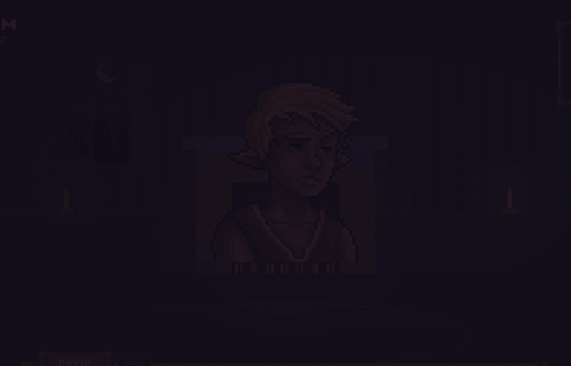
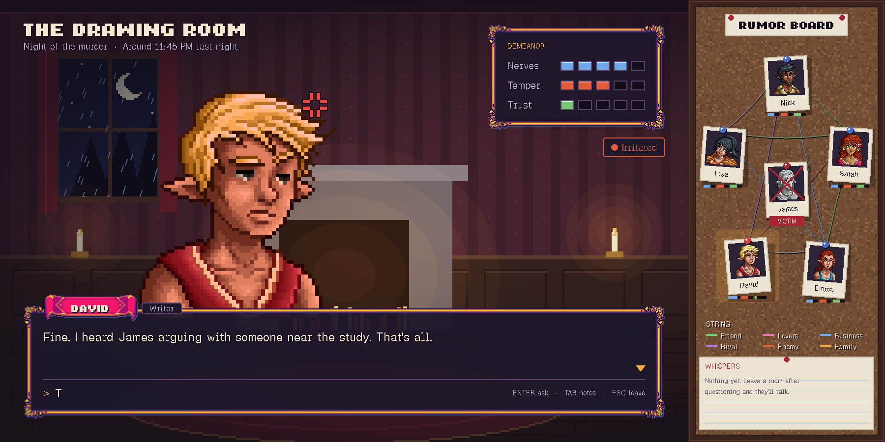
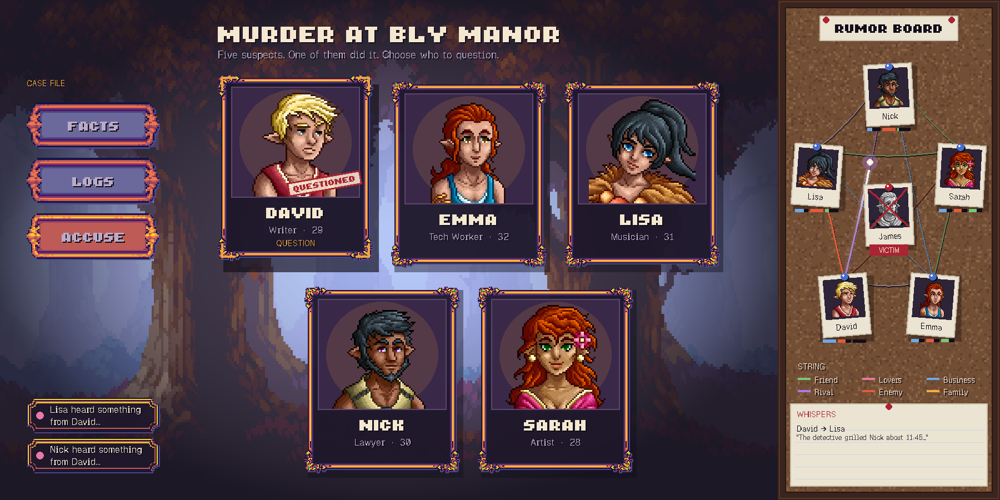
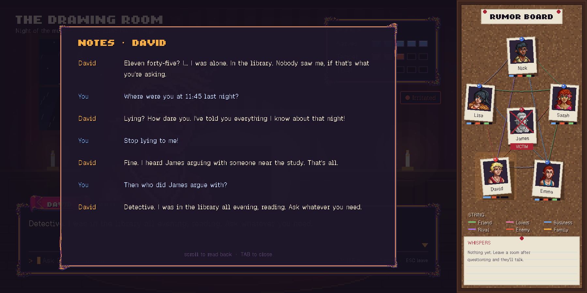

# Murder at Bly Manor

A pixel-art detective game where every suspect is an AI with its own story, secrets and temper.

Someone was killed at Bly Manor last night. Six people were in the house. One is dead, one of the other five did it, and none of them are going to make this easy.



## How it plays

Every game is a new case. The victim, the killer, the motive, the weapon, the alibis and the web of relationships between the guests are all written fresh, so you can't memorize your way to the answer.

You question the suspects one at a time, in your own words. There are no dialogue trees: ask anything, and they answer in character, in their own room of the manor.

- **Read the room.** Every suspect has three moods that shift as you talk: **Nerves**, **Temper** and **Trust**. You see it on their face. Push too hard and they break into a sweat and start mixing up their story. Be rude and the anger mark comes out. Treat them with respect and they open up. Hit a nerve and the whole room shakes.
- **Catch the lie.** Innocent suspects still hide things: affairs, debts, grudges. The killer has a story to protect. Compare what each of them tells you and look for the cracks.
- **Use your notes.** Press **Tab** in any interrogation to read back everything that suspect has said. **Facts** keeps the case details in one place and **Logs** tracks your investigation.
- **Make the call.** When you're sure, hit **Accuse**. The gavel comes down, and you'll find out whether you got it right and what really happened.

<p>
  
  
</p>

## The guests

| Name | Occupation | Personality |
| --- | --- | --- |
| **Nick** | Lawyer | Intelligent, ambitious, witty |
| **Sarah** | Artist | Creative, sensitive, observant |
| **James** | Chef | Charming, confident, jealous |
| **Emma** | Tech worker | Logical, introverted, calculated |
| **David** | Writer | Observant, sarcastic, moody |
| **Lisa** | Musician | Expressive, emotional, loyal |

Any one of them can be the victim, and any of the rest can be the killer.



## The rumor board

Turn on chaos mode and the suspects talk behind your back. Leave a room and whatever you asked spreads along the house's relationships, from friends to lovers to rivals, often bent along the way. It changes how the others treat you next.

The rumor board pins every guest to a corkboard, joined by string coloured by how they know each other. When someone passes something on, light runs down the string from the one talking to the one listening, and the line glows brighter the more it gets used. The **Whispers** card keeps the latest rumors.


## Modes

- **Chaos mode** (`--chaos true`): suspects gossip between interrogations and change their stories.
- **Rumor board** (`--visualize true`): shows the corkboard beside the game.
- **Practice case** (`--test true`): plays a fixed case instead of a new one.

Try `python3 main.py --chaos true --visualize true` once you've solved a case or two.

<p>
  
  
  
</p>

## Play it

You need Python 3.10+ and an OpenAI API key.

```bash
git clone https://github.com/notaaryansh/tuff.git && cd tuff
python3 -m venv .venv && source .venv/bin/activate
pip install -r requirements.txt
cp .env.example .env   # add your OpenAI key
python3 main.py
```

| Key | |
| --- | --- |
| Type, then **Enter** | Ask a question (Enter also skips the line that's typing out) |
| **Tab** | Notes for this suspect |
| **Esc** | Leave the room, close a window, or back out of an accusation |

## Credits

Interface art: Tiny RPG Dragon Regalia GUI by Gabriel "tiopalada" Lima and GUI Interface Kit by Jamie Cross (both CC0). Fonts: [Raster Forge](https://www.fontspace.com/raster-forge-font-f135159) (public domain) and [Geist Pixel](https://github.com/vercel/geist-font) (SIL OFL). The manor's rooms and the sound effects are made in code.

The forest background ([Oak Woods](https://brullov.itch.io/oak-woods) by brullov) and the suspect portraits (CraftPix) are licensed packs that aren't included. Without them the game uses a night sky and shadowed silhouettes. Drop them into `assets/oak_woods_v1.0/` and `assets/potrait/` for the full look.
