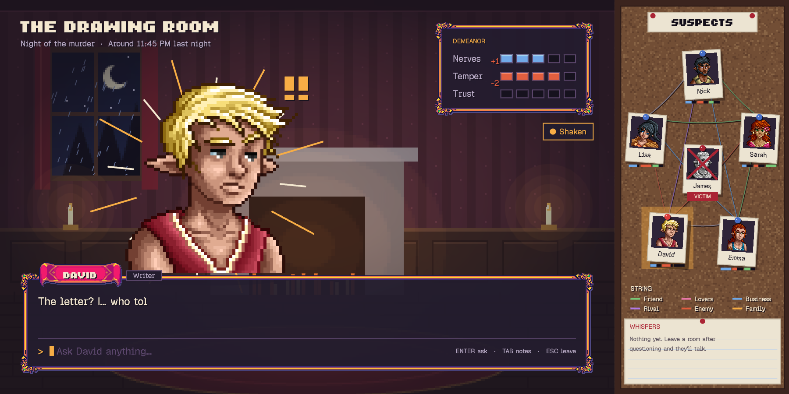
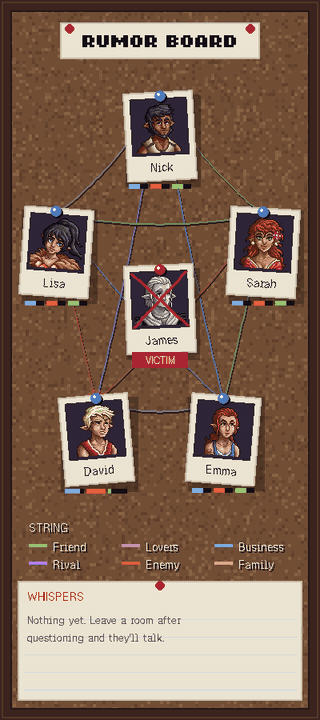
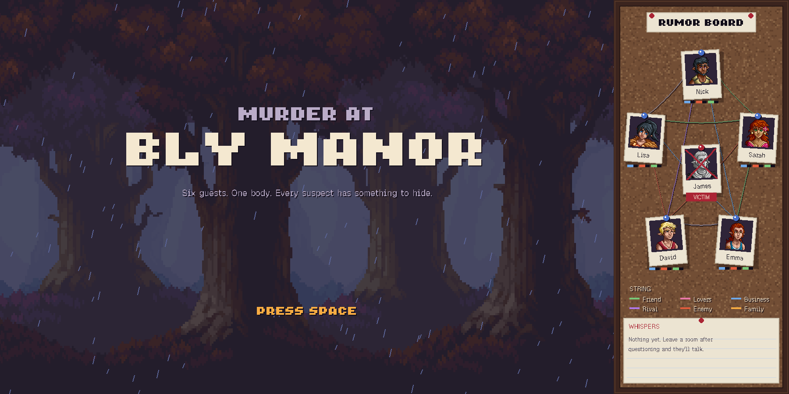
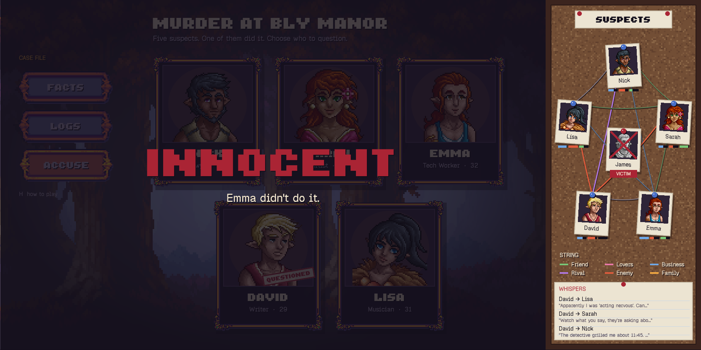

# bly manor

murder mystery game where every suspect is an ai and they all lie to you lol


so basically someone got killed at bly manor last night. theres 6 people in the house, one of them is dead and one of the other 5 did it. you go talk to them one by one and try to figure out who

every game is a new case btw. the ai makes up the victim, the killer, why they did it, everyones alibis and who hates who. so you cant just memorize it

the suspects are nick (lawyer), sarah (artist), james (chef), emma (tech), david (writer) and lisa (musician). any of them can end up dead and any of the rest can be the killer

## how it works

you just type questions, theres no dialogue options or anything. ask whatever

each suspect has nerves, temper and trust and it changes based on how you talk to them. you can see it on their face too, they start sweating if theyre nervous, get the little anger thing if you piss them off, and if you hit a nerve the whole screen shakes. be nice and they open up more, be a jerk and they lie more (kinda like real life idk)

innocent people lie too btw. everyone has some secret (affairs, money stuff, whatever) so dont assume the liar is the killer

press tab while talking to someone to see everything theyve said so far. when you think you know who did it hit accuse. you get one shot

<p>
  
  
</p>

## the rumor board

if you turn on chaos mode they gossip behind your back. you leave a room and whatever you asked gets passed around to their friends / exes / rivals, usually twisted a bit, and then they treat you different

the rumor board shows this. everyones pinned on a corkboard with string between them (color = how they know each other) and when someone tells someone something the string lights up going from one to the other. tbh my fav part




## running it

need python 3.10+ and an openai key thats it

```bash
git clone https://github.com/notaaryansh/bly-manor.git && cd bly-manor
python3 -m venv .venv && source .venv/bin/activate
pip install -r requirements.txt
cp .env.example .env   # put your openai key in here
python3 main.py
```

if you want the full thing with gossip + the rumor board:

```bash
python3 main.py --chaos true --visualize true
```

flags:
- `--chaos true` turns on the gossip
- `--visualize true` shows the rumor board on the side
- `--test true` same case every time, good if youre testing stuff

controls: type and hit enter to ask (enter also skips the text typing out), tab for notes, esc to leave a room / close stuff / cancel an accusation

<p>
  
  
  
</p>

## art and stuff

ui art is tiny rpg dragon regalia gui by gabriel "tiopalada" lima and gui interface kit by jamie cross (both cc0). fonts are [raster forge](https://www.fontspace.com/raster-forge-font-f135159) and [geist pixel](https://github.com/vercel/geist-font). the rooms and the sound effects are just made in code

the forest background ([oak woods](https://brullov.itch.io/oak-woods) by brullov) and the character portraits (craftpix) are paid packs so theyre not in the repo. game still works without them, you just get silhouettes and a plain sky. if you have them put them in `assets/oak_woods_v1.0/` and `assets/potrait/` (yes potrait is spelled wrong, its staying)
